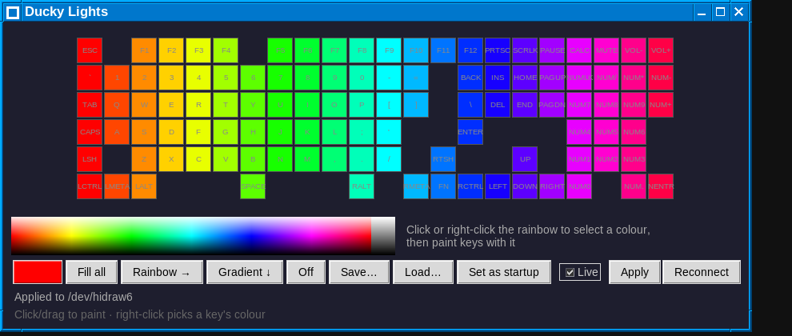

# ducky-lights

A small per-key LED control panel for Ducky keyboards on Linux, plus a
background service that holds your pattern at login. Built and tested on a
Ducky One 2 Pro (USB `04d9:0348`, ANSI layout). Python 3 with Tk, no other
dependencies.



## Use

```sh
./install.sh            # once: udev rule so your user can talk to the keyboard
python3 ducky_lights.py
```

Click or right-click the rainbow to pick a colour, then click or drag over
keys to paint them. Right-click a key to pick up its colour. Fill all,
Rainbow, Gradient and Off are one click each; Save/Load keep patterns as
JSON in `~/.config/ducky-lights`. With **Live** ticked, changes go to the
keyboard as you paint.

## Keep the pattern at login

```sh
./install-service.sh
```

Then click **Set as startup** in the panel. A systemd user service
(`ducky_lights.py --daemon`) applies that pattern, re-applies it every 15 s
and after the keyboard is replugged. Edit the path in
`ducky-lights.service` if you don't keep the repo at `~/Projects/ducky-lights`.
Stop it with `systemctl --user disable --now ducky-lights`.

## Limits

- Per-key colours only: no built-in effect modes, no brightness control.
- The pattern is **not** stored on the keyboard. It is live while programming
  mode is held open, which the panel or the service does. Leaving that mode
  reverts to the keyboard's own lighting. Saving to an on-board profile is
  not implemented because the protocol for it is undocumented.
- The key layout is inferred from the ISO layout in duckylights and corrected
  for ANSI by testing (Enter, `\|`). Other models or layouts may need
  cells moved in `parse_layout()`.

## Credits

The USB protocol comes from
[javitonino/duckylights](https://github.com/javitonino/duckylights)
(GPL-2.0). This project is licensed GPL-2.0 too.
